# PRISM

An instrumented storefront that infers browsing interest from behavioral
signals in real time. A research prototype, not a real store — see
[Honesty section](#honesty-section) below before anything else.

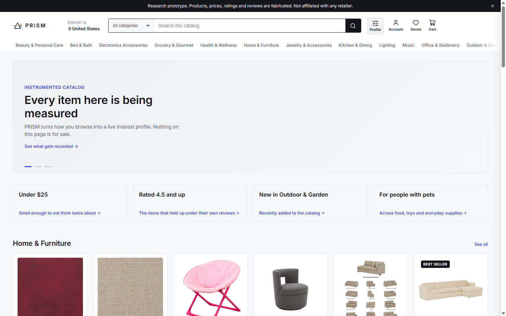

## What this is, right now

**Gate 0 is complete.** A 750-item context catalog + 60-item instrumented
core, sourced from [Amazon Berkeley Objects](https://registry.opendata.aws/amazon-berkeley-objects/)
with every brand string scrubbed from served text; a full storefront IA
(home, category, search, detail, compare, cart, checkout stub); a
consent-gated browser telemetry SDK emitting all 25 event types over
WebSocket; idempotent ingest into Postgres with live session state in
Redis; a `features/` library implementing the canonical item-view
boundary rule, the browsing-mode stratum, sealed feature windows, and a
full behavioral signal set — all with a build-failing leakage audit and
an online/offline skew test.

**Gate 1 is closed.** A drift-diffusion behavioral simulator, five
archetypes, a per-mode-conditioned generative process, and a LambdaRank
ranker recover interest ranking **reliably against a valid permutation
control, at roughly 18% of the information the commitment label
permits** — and separate the five archetypes reliably at roughly 51% of
that recovery task's own ceiling. Neither of those numbers was allowed
to stand on its own: the evaluation bar and its negative control were
both retracted and rebuilt first, because the original versions of both
turned out not to mean what they claimed to. See
["The bar was wrong" below](#the-bar-was-wrong-a-negative-control-that-couldnt-fail-and-what-replaced-both)
— that sequence, not a recovery number, is this project's actual
headline result so far.

**Gate 2 is built.** An epsilon-greedy recommender over the taste
vector (cosine candidates, MMR diversity, a permanent random-policy
slice for offline evaluation); the ablation harness above; a real
live-scoring path from a raw event batch to a pushed profile update
over the same WebSocket connection; and the five-view admin console
(§6.7). Building the last two surfaced two real bugs worth naming here
rather than only in `STATE.md`: the admin console's live view didn't
work at all in local dev (a missing Vite dev-proxy flag left its
WebSocket stuck connecting forever), and the live-scoring path itself
could silently drop a session's update under a specific, common
ordering condition — see
["Live scoring, the admin console, and the load test"](#live-scoring-the-admin-console-and-the-load-test)
below for both, and the real p95 latency number now that there's a
scoring path to measure. Deployment is prepared (`Dockerfile`,
`fly.toml`) but deliberately deferred pending a hosting decision, not
blocked on a bug — see `STATE.md`. 235 tests, all green. That's the
honest state of the project as of this commit; `STATE.md` is kept up
to date as the build continues.

## The bar was wrong, a negative control that couldn't fail, and what replaced both

This is the most credible result in the repository, and it isn't a
recovery number. It's a diagnostic sequence, and it's presented here
first because it demonstrates more about whether this project's claims
can be trusted than any single metric would.

**What happened, in order:**

1. Gate 1's original Definition of Done required Spearman ρ > 0.6
   between predicted interest and true utility on held-out simulated
   sessions. Three rounds of real engineering — coupling the simulator's
   motor model to its own decision process, adding signals that could
   read *direction* rather than just magnitude of behavior, fixing a
   real polarity bug — moved that number from 0.074 to 0.099 to 0.011.
2. Bootstrapped confidence intervals on those three numbers showed they
   were not statistically distinguishable from how much a "negative
   control" moved over the same three iterations. Read plainly: **three
   iterations of engineering were steering on a number that couldn't
   tell signal from noise.**
3. Checking the negative control itself found the actual bug: it
   permuted which item a behavior belonged to and then evaluated
   against that *same* permutation — a self-consistent replay under a
   relabeled catalog, not a test that could ever detect leakage. It had
   never been capable of failing.
4. A ceiling analysis (three oracle probes: perfect features against the
   true utility, perfect features against the actual weak label, real
   features against true utility) found the deeper problem: **the 0.6
   bar sat above what the pipeline's own label can support even with a
   perfect model** — a perfect feature against the real commitment
   label tops out around 0.33 per-session ρ. The bar was unreachable,
   not demanding.

**What replaced both:** the fixed-magnitude bar was retracted. Gate 1
now closes on a non-overlap test — the real condition's confidence
interval must not overlap a *corrected* negative control's (predictions
held fixed, only the evaluation target shuffled, so any nonzero result
under the shuffle is leakage by construction) — paired with an
*efficiency* number (achieved performance relative to the measured
ceiling, not against an arbitrary target). Retroactively, all three
historical iterations pass the corrected gate; the pipeline likely had
recoverable signal from very early on, and no tool available at the time
could see it.

**The actual result, said honestly before it's said as a table:** the
pipeline recovers interest ranking reliably against a valid permutation
control, at roughly 18% of the information the commitment label
permits. It separates the five behavioral archetypes reliably against
its own valid control too, at roughly 51% of *that* task's ceiling. A
passed gate is not the same claim as a strong result, and the efficiency
numbers — not the pass/fail column — are what say how strong. At the
fixed evaluation settings (625/625 sessions):

| | achieved | ceiling | efficiency | gate (CI vs. valid control) |
|---|---|---|---|---|
| Interest ranking (per-session ρ) | 0.088 [0.059, 0.119] | 0.497 [0.456, 0.535] | 0.178 | no overlap — control [-0.032, 0.016] |
| Archetype separation (accuracy) | 0.363 [0.326, 0.400] | 0.518 [0.480, 0.555] | 0.513 | no overlap — control [0.174, 0.238] |

**The efficiency gap between the two rows is itself a finding, not a
footnote.** The pipeline is roughly three times better at identifying
*who* a shopper is (archetype separation, 51% of ceiling) than at
ranking *what* they want (interest ranking, 18% of ceiling). That maps
directly onto the two-vector architecture (§11): the **signal-weighting
vector** — five behavioral-family weights, recovered per session by
ridge regression — is what archetype separation actually measures, and
it recovers well. The **taste vector** — the thing that would drive
ranking and recommendations, built from calibrated per-item interest —
is downstream of the *ranker*, and the ranker is the 18%-efficient
piece. In plain terms: this pipeline currently knows much more about
*which kind of shopper is browsing* than it knows about *which specific
items that shopper wants*, and a recommender built on top of it should
be trusted more for archetype-level personalization (e.g. calibrating
away from a policy that's clearly wrong for a Price-hunter) than for
fine-grained item ranking within a category. Gate 2's recommender
(below) is built with that asymmetry in mind, not around it being
already fixed.

Full sequence, every number, and the exact code for the corrected
negative control: `STATE.md`'s "Gate 1 closes" section.

## What each behavioral signal actually buys you

This is the artifact the brief for this project calls the most
interesting one in the repository, and it's worth reading as a story
rather than a table. The question it answers: of the seventeen
behavioral signals feeding the ranker — dwell, scroll, pointer velocity,
trajectory curvature, the two directional signals added after Gate 1's
recovery stalled — which ones is the model actually using, and does
removing any of them make it *better*?

**One signal is carrying almost the entire result.** Item dwell —
`log(1 + seconds visible)`, the single oldest and simplest signal in the
project — accounts for essentially all of the ranker's positive
contribution on its own. Removing it costs 0.078 of per-session ρ;
removing dwell's entire family (which also includes viewport time, hover
time, and focused-idle time) costs 0.074 — meaning the other three
attention signals add almost nothing on top of dwell alone. Four
signals — category breadth, hover time on target, query specificity,
and viewport time — contribute *exactly* zero: LightGBM found no useful
split on any of them, so removing them changes the model's predictions
not at all. They aren't wrong to have built; they're evidence that this
model, at this data volume, isn't using everything it's given, and
that's a more honest thing to know than not measuring it.

**Two families actively hurt.** This is the finding worth not looking
away from. The `comparison` family (revisit count, near-substitute
co-view count) and the `directional` family (the two signals built
specifically to give the ranker a way to read *which* item a trajectory
leaned toward — [see above](#the-bar-was-wrong-a-negative-control-that-couldnt-fail-and-what-replaced-both))
both show a **reliably negative** contribution: the model does
measurably *better* on held-out sessions with them removed, not worse.
That directly contradicts what their individual correlation with the
outcome suggested in isolation. The likely explanation — a signal
correlating with the label on its own is not the same claim as it
improving a multi-feature tree ensemble's generalization, and with the
current training volume the ranker may be fitting noise in these
signals' sparser availability patterns rather than real structure — is
recorded as a hypothesis, not verified further, since re-tuning the
ranker to fix it was explicitly ruled out once Gate 1 closed. Both
things are true at once: the directional signals are a real,
mechanistically-grounded addition to the generative model, and they are
*currently* net-harmful to this particular trained ranker. The ablation
is what makes the second half of that visible instead of assumed away
by the first half.

| Family | Contribution (Δρ if removed) | 95% CI | Reading |
|---|---|---|---|
| attention | **+0.074** | [+0.051, +0.096] | clearly helps — almost entirely dwell |
| motor_conflict | −0.004 | [−0.021, +0.013] | no measurable effect |
| exploration | −0.014 | [−0.031, +0.002] | no measurable effect |
| comparison | −0.025 | [−0.042, −0.008] | reliably hurts |
| directional | −0.042 | [−0.068, −0.018] | reliably hurts |

Full per-signal table, the paired-bootstrap methodology, and the raw
numbers behind this narrative: `STATE.md`'s "Ablation harness" section.
Reproduce it with `python -m eval.ablation`.

## Live scoring, the admin console, and the load test

The recovery numbers above are all against the simulator. This section
is about the separate question of whether the *real-time* path — a
visitor's actual browsing, scored and pushed back to their own profile
panel live — actually works, and it's reported the same way as
everything above: real numbers from actually running it, including the
two real bugs that running it (not reading the code) found.

**The live path works, end to end, verified against a real browsing
session** — not just tests: opened the storefront, browsed several
product pages, and watched the profile panel go from its empty state to
ranked, human-readable dimensions ("Trusts items with more reviews,"
"Leans toward premium brands," ...), updating live as more items were
viewed. Getting there and then building the admin console's live view
on top of it surfaced two real bugs:

1. **The admin console's live view never connected, in local dev,
   ever.** Every session showed "Disconnected," with no error on either
   side. Cause: Vite's dev proxy had `ws: true` set only on the `/ws`
   rule, not on `/api` — and the admin live socket lives at
   `/api/admin/live/{id}`, so the upgrade request was proxied as plain
   HTTP and sat in `CONNECTING` forever. One line in `vite.config.ts`;
   found by the required two-pass screenshot review of the admin
   console (below), not by reading the code.
2. **A session's live update could silently vanish** depending on the
   alphabetical order of the item IDs a shopper happened to browse.
   `score_session_update` decided "has anything new closed" by looking
   at the *last* recomputed view — but the function computing those
   views sorts them by item ID (for the admin console's own grouped
   display), not by time. Whenever the most-recently-closed view's item
   ID didn't sort last, the check looked at an already-scored view
   instead, and the whole update disappeared with no exception and no
   push. A shopper would just never see that view reflected in their
   own profile, with nothing in the logs to say why. Found building the
   load test below, which is exactly the kind of bug a load test is
   supposed to find and a unit test in isolation would not have (the
   existing unit tests all happened to use item IDs that already sorted
   in time order). Fixed, with a regression test that reproduces the
   exact ordering that hid it.

**The admin console** (Sessions list, Session detail, Event log,
Signal distributions, Live view) got the same two-pass,
two-viewport screenshot review as the storefront, per this project's
own standing review discipline — arguably more scrutiny, since it's
the surface a technical reader spends the most time on. That review is
what caught bug #1 above, plus half a dozen smaller-but-real issues:
a table that silently clipped three columns (including the only link
to the live view) at narrow widths with no scrollbar; a `cursor:
pointer` that silently never applied because of a CSS-Modules class
name mismatch; a mobile nav row that never actually wrapped because a
`width: 100%` lost to a sibling rule's `flex-basis: 0` on specificity;
payload columns that looked truncated with no indication they were;
and a signal-distributions view that fetched each histogram bin's value
range but never showed it, undercutting the panel's own stated
purpose. Full list, each with what was actually wrong and the fix:
`STATE.md`'s "Admin console" section. Screenshots, both viewports:

| | |
|---|---|
| Sessions list | 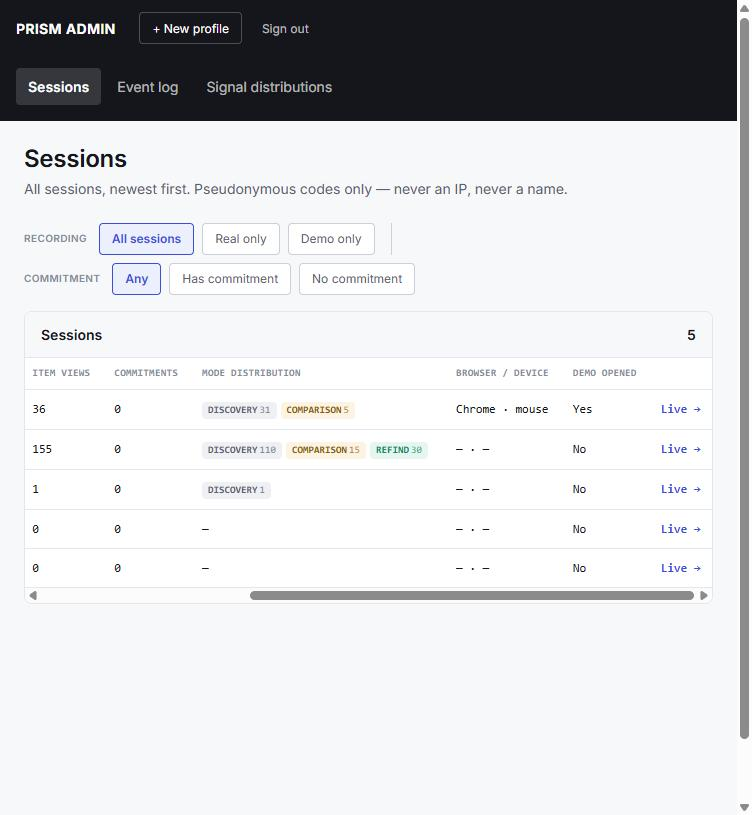 |
| Session detail | 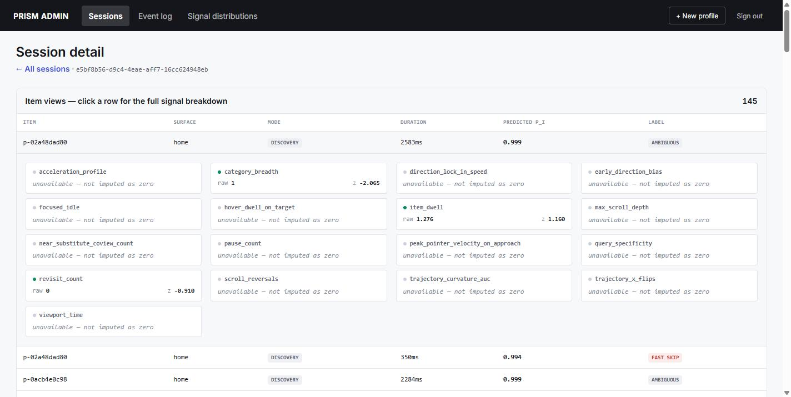 |
| Event log | 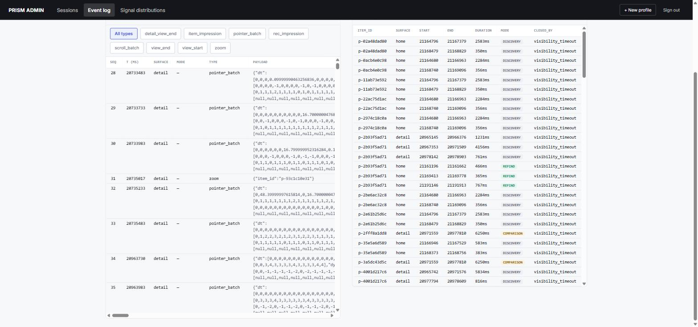 |
| Signal distributions | 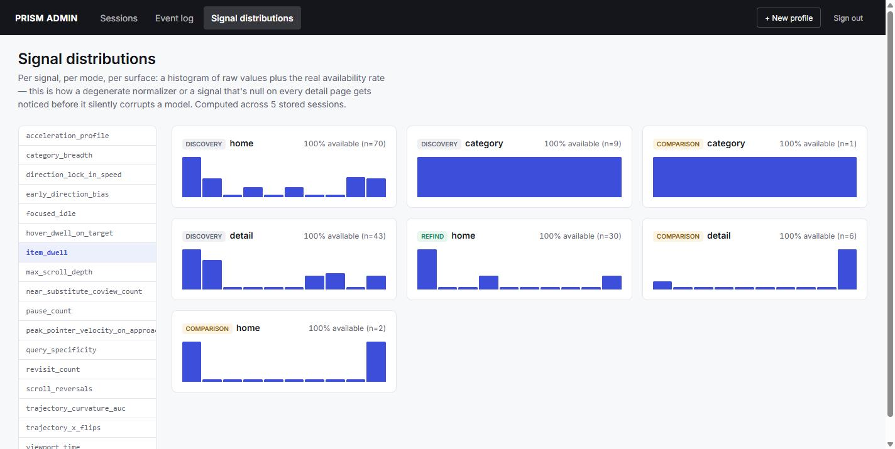 |
| Live view | 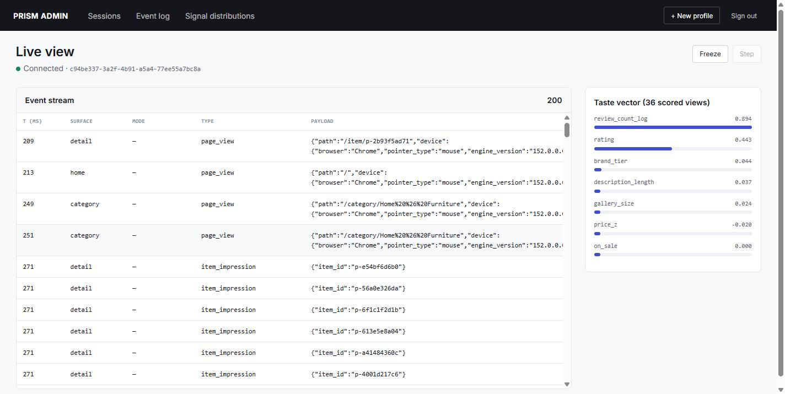 |

**The load test** (`python -m eval.load_test`) measures §12's actual
budget — p95 < 250ms from a semantic trigger (here, a batch that closes
a canonical view) to the pushed update on the same connection — against
the real local dev stack, over real WebSocket connections, not against
the simulator and not against a deployed URL (deployment is deferred;
a local run measures the application's own latency, which is what the
budget is about, without conflating in network latency to whatever
region a deployed instance would run in):

| run | triggers | dropped | p50 | p95 | p99 |
|---|---|---|---|---|---|
| 20 sessions × 5 triggers | 100 | 0 | 39.9ms | 73.4ms | 79.1ms |
| 40 sessions × 8 triggers | 320 | 0 | 78.5ms | 138.4ms | 161.1ms |

**PASS on both runs**, with real headroom — but said plainly rather
than as a bare pass: this is ordinary dev hardware with a single
backend process and a handful of concurrent sessions, not production
infrastructure under production load, and it's the number *after*
fixing the dropped-trigger bug above, which for a while made "0
dropped" the more important column than the latency one.

## Screens

The profile panel, live, over one real browsing session — empty state to
ranked dimensions, no fabricated "updating" animation, this is an actual
recorded run against the real live-scoring path described above:

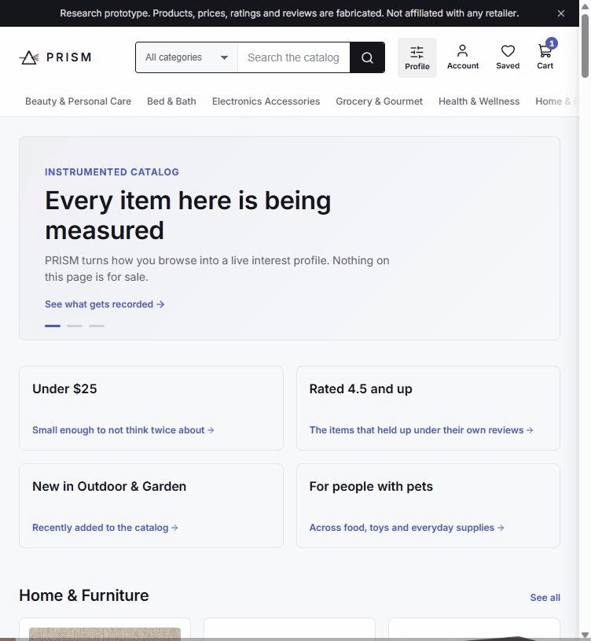

| | |
|---|---|
| Consent gate | 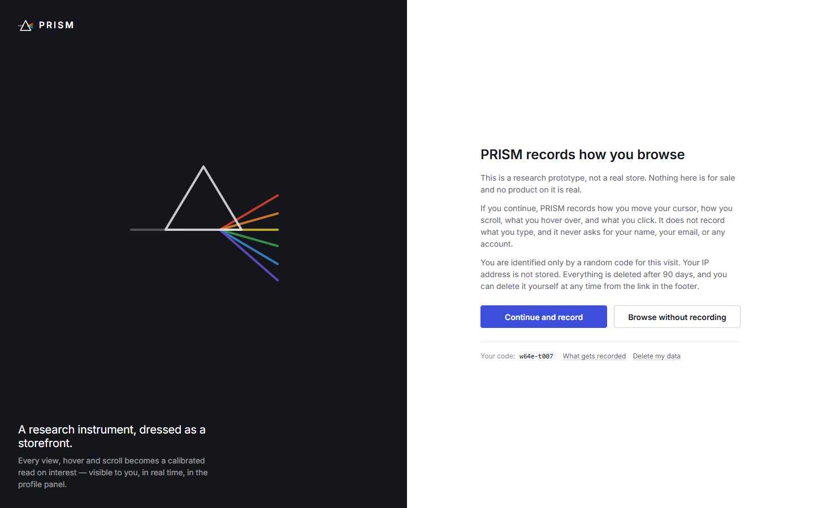 |
| Category | 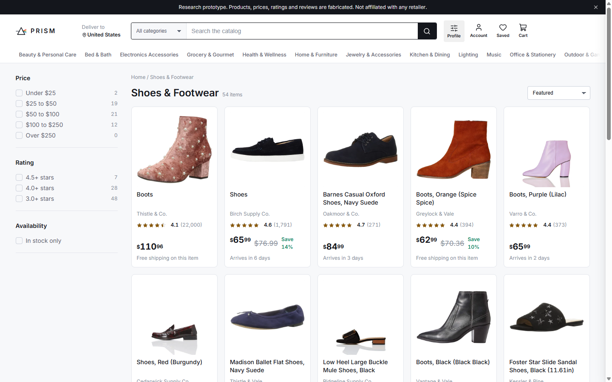 |
| Search | 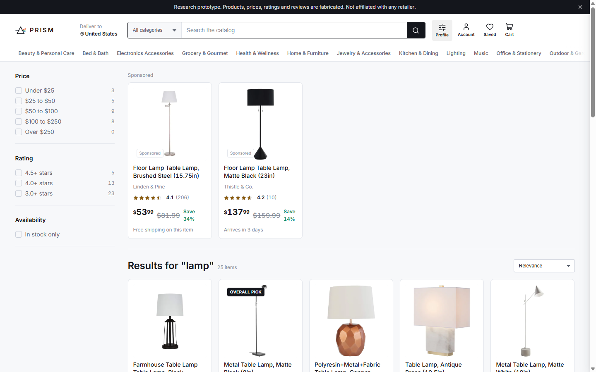 |
| Product detail | 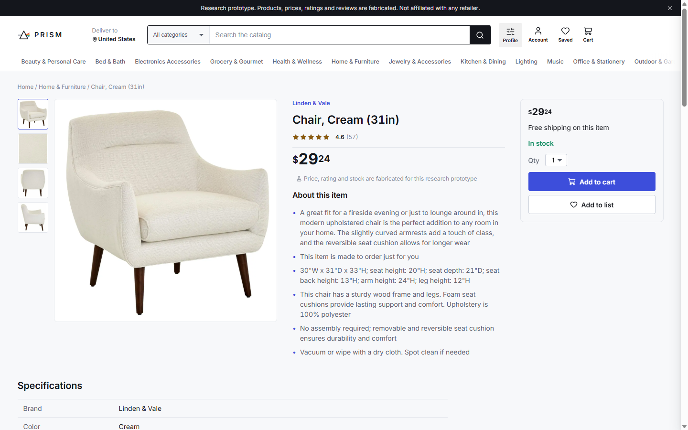 |
| Compare | 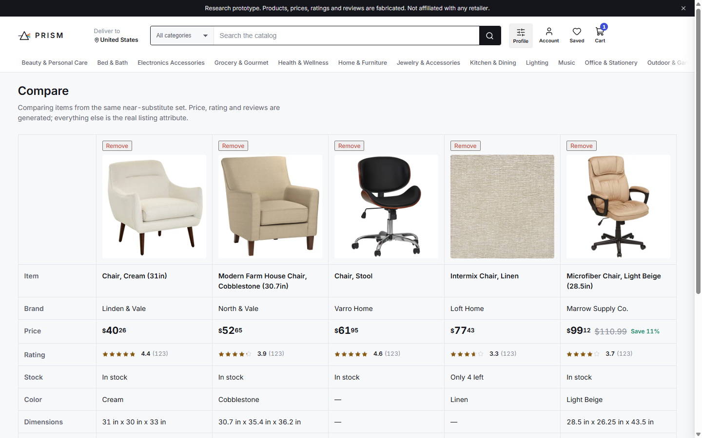 |
| Cart | 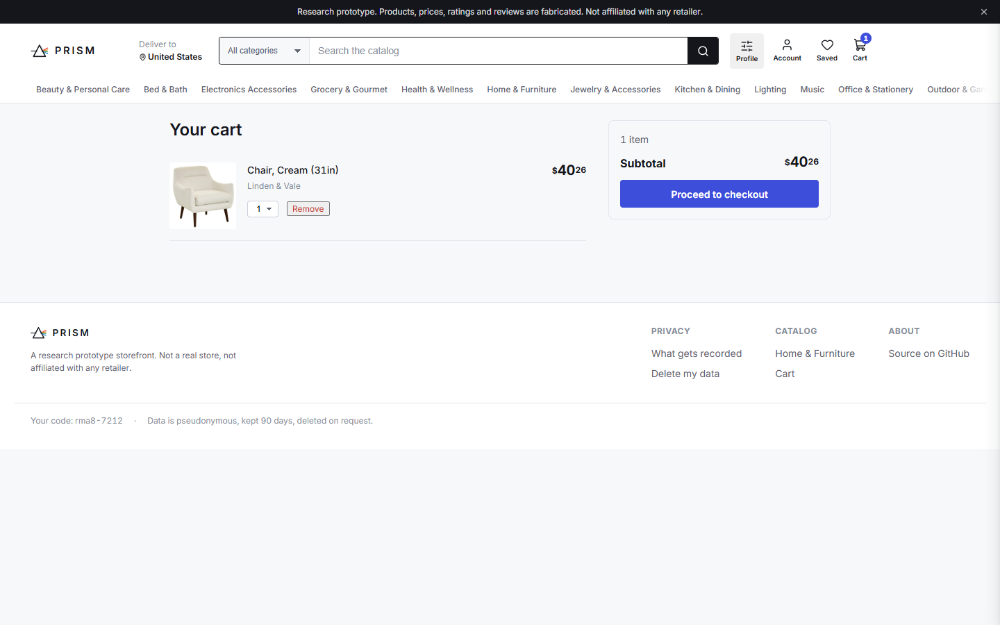 |

More surfaces, empty/loading states, and the 768px layouts are in
[`docs/screens/`](docs/screens/).

## Architecture

```
catalog/     ABO ingest, brand masking, synthetic attributes, thumbnails
sdk/         browser telemetry (TypeScript, framework-agnostic)
web/         React storefront
server/
  ingest/    WebSocket + HTTP endpoints, Postgres + Redis
  features/  window-spec'd signal functions — the leakage-critical module
  models/    taste vector (Gate 1); trained ranker + live scoring (Gate 2)
  recommender/  candidate gen, MMR rerank, epsilon-greedy policy (Gate 2)
sim/         behavioral simulator: five archetypes, drift-diffusion + motor coupling (Gate 1, done)
eval/        corpus, ranker, signal-weighting recovery, negative control, ceiling probes, diagnostics (Gate 1, done)
tests/
```

`server/features/` imports nothing from `ingest`, `models`, or
`recommender` — enforced by `import-linter`, not just convention (see
`pyproject.toml`).

The single most load-bearing piece of the whole project is
`server/features/item_view.py`: one function, unit-tested against six
required hand-built visibility timelines, that decides what counts as a
"view" and therefore everything downstream measures. Next to it,
`server/features/mode.py` implements the browsing-mode stratum — the
brief's central modeling claim that dwell time means opposite things in
directed search versus discovery browsing, so mode is a stratum you
calibrate and report separately per §4, never a pooled feature column.

## Running it locally

```powershell
# Postgres + Redis
docker compose up -d

# Python backend
uv venv .venv
uv pip install -e ".[dev]"
.venv\Scripts\python.exe -m uvicorn server.main:app --port 8000

# Catalog (first run only — pulls from the public ABO S3 bucket, ~90MB
# metadata + ~200MB of resized thumbnails, both gitignored)
.venv\Scripts\python.exe -m catalog.build

# Frontend
cd web
npm install
npm run dev
```

Copy `.env.example` to `.env` first — the defaults already match
`docker-compose.yml`.

### Tests

```powershell
.venv\Scripts\python.exe -m pytest tests/ -q
```

### The admin console

Password-gated (`ADMIN_PASSWORD` in `.env`; fails closed if unset),
mounted at `/admin`, not linked from the storefront. Five views:
Sessions, Session detail, Event log, Signal distributions, Live view —
see ["Live scoring, the admin console, and the load test"](#live-scoring-the-admin-console-and-the-load-test)
above for what building and reviewing it actually found.

### The manual gate

Gate 0's Definition of Done includes one check that's the author's to do,
not the agent's: browse a session, open the raw event log, and confirm
by hand that view boundaries and modes match what actually happened. The
tool for that is the admin console's Event log view (`/admin/event-log`)
— paste the session code shown in the site footer, or a session_id, to
see the raw event log next to the offline-recomputed canonical views
and modes side by side.

## Honesty section

> **What this shows.** A real-time pipeline from raw browsing behavior to
> a durable, idempotent event log, over a 750-item catalog with a full
> e-commerce IA. Browsing mode is modeled as a stratum from the start,
> because dwell time means opposite things in directed search and in
> discovery browsing. The canonical item-view boundary rule, the sealed
> feature windows, and the leakage audit are built and tested before any
> model exists to leak into — that ordering is deliberate.
>
> **What this does not show yet.** Anything about real (non-simulated)
> shoppers at any meaningful volume — the recommender, the ranker, and
> the ablation above are all trained and measured against the
> simulator; the live-scoring path and its 250ms budget are verified
> against real telemetry, but from a handful of manually-driven
> sessions and a load test's synthetic WebSocket traffic, not real
> visitors at scale, and not against a deployed instance (deployment is
> prepared but deliberately deferred — see `STATE.md`). The ranker recovery
> numbers above (efficiency 0.178 for interest ranking, 0.513 for
> archetype separation) are the honest, ceiling-relative headline —
> see ["The bar was wrong"](#the-bar-was-wrong-a-negative-control-that-couldnt-fail-and-what-replaced-both)
> for why a fixed target number isn't reported instead. The ranker was
> trained entirely on simulated sessions, and the simulator only ever
> produces card-impression-shaped views (§Screens' `detail-view-start`
> gap, closed in the live path after this point — see `STATE.md`) — so
> the deployed scorer now sees a real surface (`detail`) the simulator
> has never produced a single training example of, with dwell
> distributions outside anything it trained on and a per-(session, mode,
> surface) normalizer that will be unstable on that stratum until enough
> detail views accumulate in a session. **Live interest scores are not
> covered by the reported recovery numbers above, which were measured on
> card impressions only.** This is stated rather than fixed by adding
> detail views to the simulator, which would be a real change to the
> generative model and is out of scope for a close-out pass. Browsing mode's
> measured contribution to a future ablation will be partly a
> consequence of how the simulator itself was parameterized (see
> `STATE.md`'s per-mode DDM priors) — those per-mode priors are stated
> modeling assumptions about shopper behavior, not measured facts, so an
> ablation result attributing signal to mode should be read as "the
> simulator's stated hypothesis about mode was recoverable," not as
> independent evidence that the hypothesis is true of real shoppers. The
> simulator also assumes motor output (cursor trajectories, scroll
> pacing) is coupled to the evolving decision state as it accumulates,
> not independent of it, per the mouse-tracking literature (Leontyev &
> Yamauchi 2021, §16) — that assumption is what makes recovering interest
> from behavior possible at all. It is an assumption the simulator is
> built on, not a finding this project has demonstrated. Two directional
> motor signals were added only after diagnosing that the original
> eighteen-signal set — despite the coupling above making direction
> mechanistically real in the simulated data — measured only the
> magnitude and shape of behavior (how long, how fast, how curved) and
> nothing about *which* of two on-screen destinations a trajectory leaned
> toward; see STATE.md for the finding in full, including that the two
> new signals individually correlate with the outcome far more than
> anything else measured so far.
>
> **Fabricated content.** Product images derive from Amazon Berkeley
> Objects under CC BY-NC 4.0 and some show manufacturer logos on
> packaging — that's an accepted, licensed residual case (see `NOTICE`
> and `BUILD_BRIEF.md` §5.3), not an oversight. All brand names in the
> listing text are invented; prices, ratings and reviews are generated
> and labeled as such in the interface. Nothing here describes a real
> product, and this site is not affiliated with any retailer and copies
> no retailer's identity.
>
> **On inferring intent from motor behavior.** Cursor position is a weak
> proxy for attention: inactive over half the time, lagging gaze by
> roughly 700ms, with large individual variation. Mouse dynamics are also
> re-identifiable, which is why telemetry here is consent-gated,
> pseudonymous and deleted after 90 days (and on request — see
> `/delete-my-data`).

## License

MIT for this repository's own code — see `LICENSE`. `NOTICE` has the full
ABO attribution and the dataset's CC BY-NC 4.0 terms, which apply to the
catalog imagery/metadata only, never to the code.
